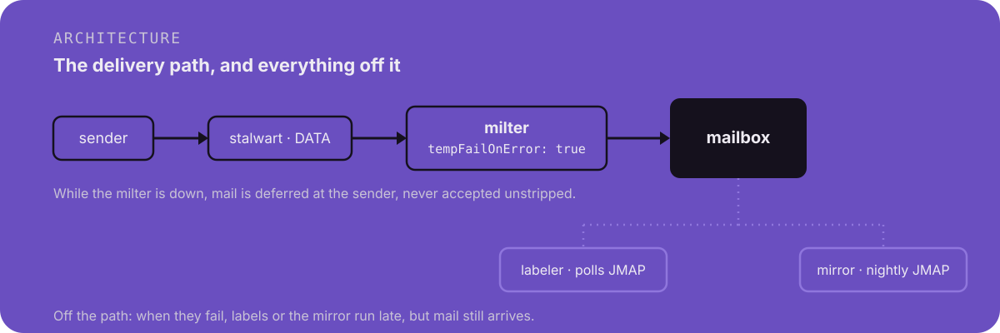

<p align="center">
  
</p>

<p align="center">
  <a href="https://github.com/Verdenroz/corvid/actions/workflows/ci.yml"></a>
  <a href="LICENSE"></a>
</p>

Self-hosted email for one person, built on [Stalwart Mail Server](https://stalw.art), with
tracker stripping and local labeling that never send mail anywhere else.

## Status

Early. The deployment and every service have tests and have run end to end on a test host, but
not yet in long-term use. Expect sharp edges, and read `deploy/RUNBOOK.md` before deploying.
`install.sh` ends by running `deploy/verify.sh`, which checks observable state (services, DNS,
firewall packet counters, the milter handshake) rather than a single test send.

<h2></h2>

Corvid is a deployment plus a set of small Rust services that run beside Stalwart:

- A milter rewrites HTML mail as it is delivered. It drops images declared as zero size and sends
  every other remote image through a signed image proxy, so the sender never sees your IP address
  or mail client. The proxy fetches on first open, so the sender can still learn when that was.
- A labeler learns per-sender labels from the keywords you set in your mail client. For senders
  it has not seen, it can optionally ask a model on a machine you own for the probability of each
  label, and writes one only when the model is confident.
- A mirror on a second machine pulls the whole mailbox over JMAP every night, then checks the
  copy for missing messages and damaged bodies.
- Stalwart's own settings come from a plan file applied with `stalwart-cli`, not from clicking
  through its web UI.

<p align="center">
  
</p>

Mail goes out from your own IP with no relay in between. The server can read your mail, because
search and labeling run on it. Mail is encrypted in transit with TLS; encrypting the disk is up to
you.

## Before you install

These happen at your provider, registrar and Cloudflare, so the installer cannot do them:

1. Get a VPS running Debian 13 or Ubuntu 24.04 (or newer), x86_64 or ARM, where outbound port 25
   is open and you can set the reverse DNS (PTR). Many providers block port 25 by default; some
   open it on request and some never do, so check before you pay. Debian 12's Podman is too old.
2. Pick the name the server will go by, for example `mail.example.com`, and set the IP's PTR
   record to it in the provider's control panel. The installer creates the A record itself.
3. Put the domain on Cloudflare and create an API token for it: My Profile, API Tokens, Create
   Token, Custom token, with Zone / DNS / Edit and Zone / Zone / Read on that zone (and on the
   hostname's zone, if it differs). Restrict the token to the server's IP if you can.
4. If the provider has its own firewall or security groups, open 25, 465, 587, 993, 80 and the
   web port (443 by default) there.

<h2></h2>

From a checkout of this repository, on your own machine, with the SSH key that logs in to the
server as root or as a user with passwordless sudo:

    ./install.sh --ssh-key ~/.ssh/id_ed25519 root@mail.example.com

On a fresh server it first offers to install the packages Corvid needs (Podman, ufw and a few
tools) and to turn on the firewall with SSH allowed. It then asks seven questions in turn: your
email address and its password, the server's name (it suggests the one its reverse DNS gives),
the web port, where your mail apps may connect from, an address for certificate notices, and a
Cloudflare token, which it checks with Cloudflare as soon as you enter it. An answer that is not valid is asked again.

It also offers to turn on DNSSEC for your zones. With DNSSEC on, the TLSA records Corvid
publishes let senders that check DANE, such as Microsoft, refuse to deliver to you over anything
but TLS with your real certificate. If a domain is registered somewhere other than Cloudflare,
add the DS record the installer prints at that registrar. MTA-STS, which Gmail checks instead, is
published only when the web port is 443, since senders fetch its policy there and nowhere else.

If you answer `host` to where mail apps may connect from, ports 465, 587, 993 and the web port
are closed to the internet and reachable only by programs on the server, such as a VPN it runs:
your devices then need that VPN to read or send mail. Mail from other servers still arrives on
port 25.

The server's own public address is exempt from Stalwart's automatic bans, so a VPN or other
service on the same machine cannot get every connection through it blocked.

Before changing anything else it checks the hostname's DNS, the PTR record, outbound port 25 and
free ports, and warns if the server's IP is on a mail blocklist. It then shows your answers for
a final yes. After that it needs nothing from you: it creates the A record if there is none,
installs, publishes your DNS records, waits for certificates, verifies the result, and checks
from your machine that the mail ports answer. `./install.sh --help` lists the options. There is
nothing to build: the server pulls the published image.

Rerun it to change a setting or replace the token or password. Each question offers the value
already on the server, and Enter keeps it. You never need to edit files on the server.
`deploy/uninstall.sh` on the server removes Corvid again (`--purge` also deletes the mail).

You can add two machines later: one for the mirror, and one serving an OpenAI-compatible model
endpoint that returns logprobs (llama-server, for example) over WireGuard, which the labeler uses
for senders it has not seen yet. `deploy/RUNBOOK.md` covers both, and every step `install.sh`
automates.

On Kubernetes, `charts/corvid` runs the same pod from the same `config.yaml` schema. It has
run on a local kind cluster but not yet on a production one; its README covers the first run
and what mail needs from a cluster.

Mail from a new domain lands in spam at first, even with SPF, DKIM and DMARC passing. Reputation
comes from time and from people replying to you, so start with correspondents who will.

## Development

```sh
cargo test
cargo fmt --all --check
cargo clippy --workspace --all-targets -- -D warnings
./deploy/check-plan.py    # checks the Stalwart plan's field shapes
```

The workspace layout and the reasoning behind it are in `CLAUDE.md`, which is written for
contributors whether or not they use Claude Code.

## Performance

Two hot paths are benchmarked: the milter's HTML rewriter in Rust and the client's HTML reader in
Kotlin. Prose below is bound to the code it describes, and the numbers are checked against the
baseline named `base`.

### Rust: the HTML rewriter

<!-- soothfast:bind corvid_rewrite::Rewriter -->
A `Rewriter` holds the signer and the proxy base. Its `rewrite` streams one HTML document through
`lol_html`, removes remote images declared zero or 1x1 as trackers, and replaces every other remote
image, `srcset`, `background`, `input[type=image]` and `video` poster, and every `url()` in a style
attribute or `<style>` block, with a signed URL on the image proxy. Links keep their targets but
lose tracking query parameters. Parsing is capped at 8 MiB, past which the rewrite fails.
<!-- /soothfast:bind -->

<!-- soothfast:bind corvid_rewrite::Report -->
The `Report` returned with the rewritten document counts stripped and proxied references and lists
every remote host the message tried to reach, with the hosts of stripped pixels also kept apart as
trackers.
<!-- /soothfast:bind -->

<!-- soothfast:claim corvid_rewrite::bench_rewrite_newsletter.alloc.allocs <= 2200 -->
Rewriting a twelve-section newsletter costs at most 2200 allocations.
<!-- /soothfast:claim -->

<!-- soothfast:claim corvid_rewrite::bench_rewrite_tracking_pixels.walltime.median_ns < 200000 -->
Stripping sixty-four tracking pixels takes under 200us at the median.
<!-- /soothfast:claim -->

### Kotlin: the HTML reader

<!-- soothfast:bind client/core/html/src/commonMain/kotlin/com/verdenroz/corvid/core/html/HtmlToBlocks.kt#Flow.image -->
The reader drops an image whose declared width or height is 1 or less, which removes the pixels
the milter did not already strip. An image it keeps carries a URL only if that URL starts with the
user's own proxy path or is a `cid:` part of the message. Any other source becomes an image with no
URL, so the app never fetches it.
<!-- /soothfast:bind -->

<!-- soothfast:bind client/core/html/src/commonMain/kotlin/com/verdenroz/corvid/core/html/LinkMismatch.kt#mismatchedHost -->
A link is marked as mismatched when its visible text reads as an address on one host and its href
points at another. Text that does not look like an address never counts, and a leading `www.` is
ignored on both sides.
<!-- /soothfast:bind -->

The Kotlin benchmarks live in `client/benchmarks` and run with
`./gradlew :benchmarks:mainBenchmark --max-workers=2`. Their JSON report is imported into the same
baseline as the Rust items with
`cargo soothfast import --from jmh <report.json> --save-baseline base`.

<!-- soothfast:claim jmh::com.verdenroz.corvid.benchmarks.HtmlBenchmarks.blocksNewsletter[mode=avgt].walltime.median_ns < 500000 -->
Turning a twelve-section newsletter into blocks takes under 500us on average.
<!-- /soothfast:claim -->

## License

MIT, see [LICENSE](LICENSE). Stalwart itself is AGPL-3.0 and runs from its upstream image;
Corvid does not modify or redistribute it.
