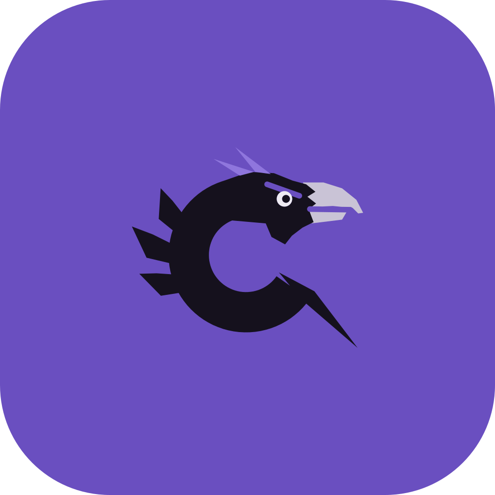

<p align="center">
  
</p>

<h1 align="center">Corvid</h1>

<p align="center">
  <a href="https://github.com/Verdenroz/corvid/actions/workflows/ci.yml"></a>
  <a href="https://github.com/Verdenroz/corvid/actions/workflows/image.yml"></a>
  <a href="https://verdenroz.github.io/corvid/"></a>
  <a href="LICENSE"></a>
  
  
  
</p>

Self-hosted email for one mailbox, built on [Stalwart](https://stalw.art). Corvid strips trackers
at delivery and sends nothing through a relay.

> [!NOTE]
> Corvid is early. Read the [guide](https://verdenroz.github.io/corvid/) before deploying.

## Features

- Tracker stripping at delivery, with remote images loaded through a signed proxy
- Android and Linux desktop app, JMAP only, with passkey sign-in
- Push notifications and per-sender aliases
- Labels learned from the ones you set, with an optional model for new senders
- SPF, DKIM, DMARC, DANE and MTA-STS published for you through Cloudflare
- Nightly updates that roll back on a failed check
- Encrypted off-host mirror with restore

## Getting started

You need a VPS with outbound port 25 open and a domain on Cloudflare. From a checkout on your
own machine:

```sh
./install.sh --ssh-key ~/.ssh/id_ed25519 root@mail.example.com
```

The [setup guide](https://verdenroz.github.io/corvid/setup/) covers what to prepare first, what
the installer asks, and signing in from the app.

## Development

```sh
cargo test
cargo clippy --workspace --all-targets -- -D warnings
./deploy/check-plan.py
cd client && ./gradlew check
```

Architecture and conventions are in `CLAUDE.md`.

## License

MIT. Stalwart is AGPL-3.0 and runs unmodified from its upstream image.
